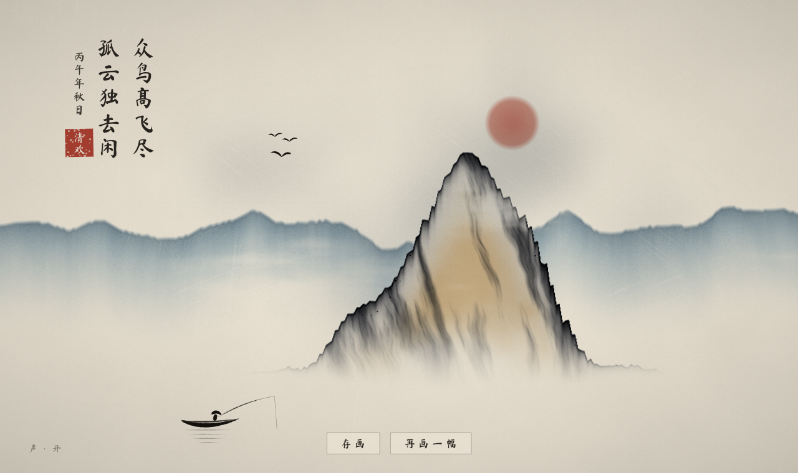

# 墨

一滴墨，落入清水。

一个浏览器里的水墨小游戏：在水中落墨、行笔，墨用尽后，水静下来，你留下的墨会凝成一幅山水——墨迹的上沿成了山脊，再题上一句古诗，盖一方朱印。

## 玩法

- **按住**：蓄墨，按得越久墨珠越大
- **松手**：落墨
- **拖动**：行笔
- 墨用尽，或点「成画」，画就成了

## 运行

单个 `index.html`，用支持 WebGL2 的浏览器直接打开即可。
